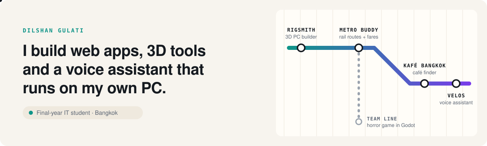
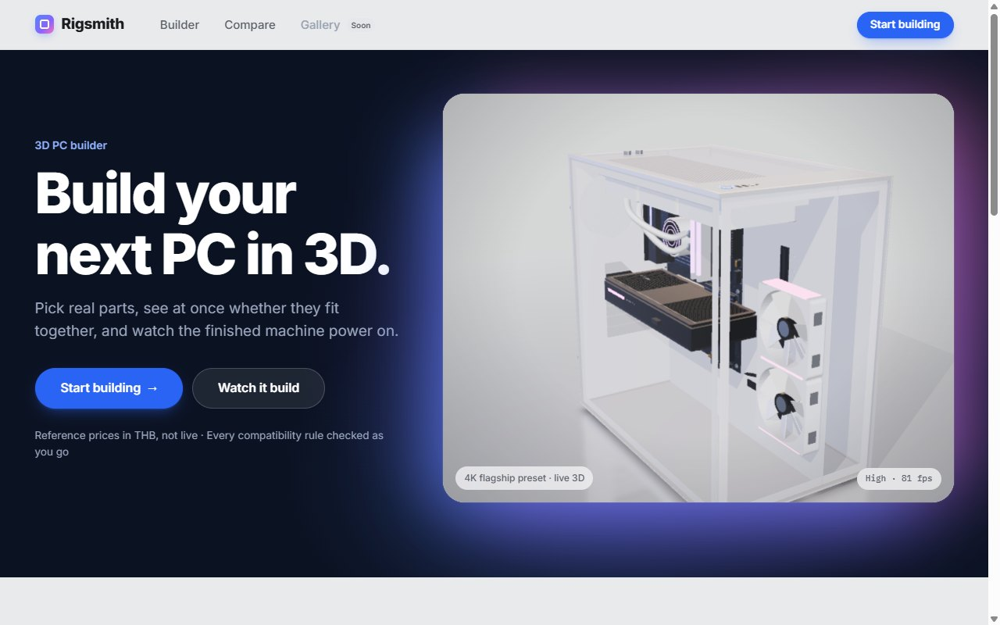
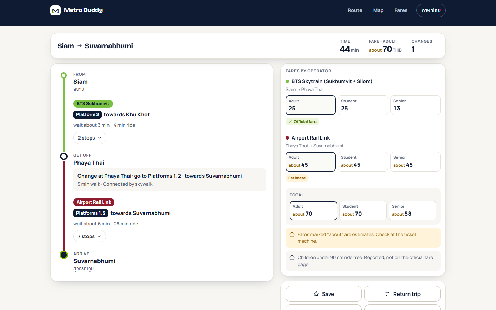
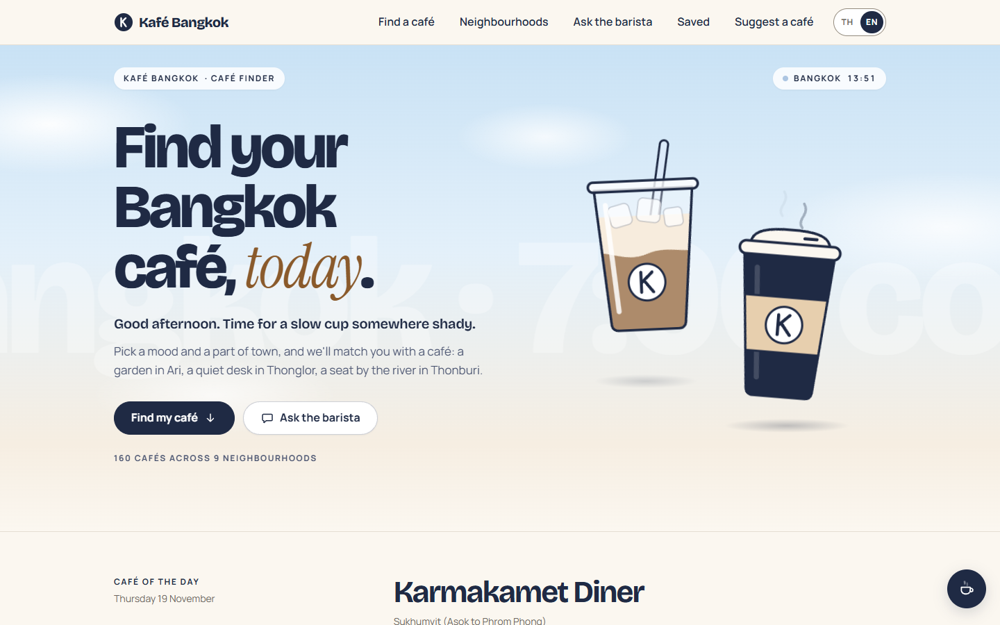
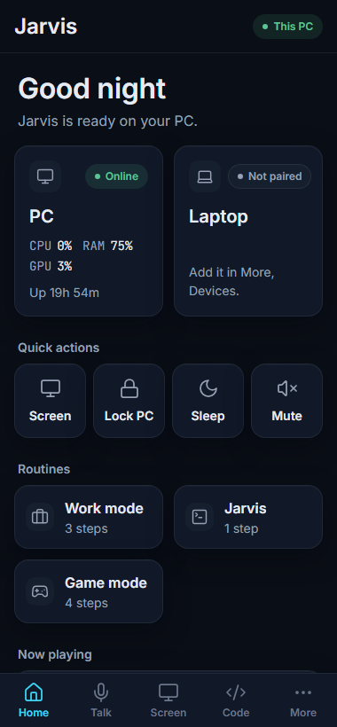

<picture>
  <source media="(prefers-color-scheme: dark)" srcset="assets/header-dark.svg">
  
</picture>

Hi, I'm Dilshan. I'm a final-year IT student in Bangkok. I like projects where the details have to be right: real PC parts that must fit together, real train fares, real cafés with real opening hours. When my apps can't check something, they say so instead of guessing.

**Try them live:** [Rigsmith](https://rigsmith.netlify.app) · [Metro Buddy](https://metro-buddy.netlify.app) · [Kafé Bangkok](https://kafebangkok.netlify.app)

## Projects

<table>
  <tr>
    <td width="56%" valign="middle">
      
    </td>
    <td width="44%" valign="middle">
      <h3>Rigsmith</h3>
      
A 3D PC builder in the browser. Pick parts and it checks straight away whether they fit. Then build the PC by hand, cables included, or press Auto-build and watch it assemble and power on.

      
<b>342</b> real parts · <b>9</b> categories · a rule-based compatibility engine

      
<code>JavaScript</code> <code>three.js</code> <code>Netlify</code>

      
<a href="https://rigsmith.netlify.app">Live demo</a> · <a href="https://github.com/dilshangulati07-crypto/rigsmith">Code</a>

    </td>
  </tr>
  <tr>
    <td width="44%" valign="middle">
      <h3>Metro Buddy</h3>
      
A route finder for Bangkok's trains. It gives the fastest route, the platform for every ride and the fare for adults, students and seniors, in English or Thai.

      
<b>10</b> lines · <b>195</b> stations · Dijkstra's algorithm for routing

      
<code>JavaScript</code> <code>SVG</code> <code>Netlify</code>

      
<a href="https://metro-buddy.netlify.app">Live demo</a> · <a href="https://github.com/dilshangulati07-crypto/metro-buddy">Code</a>

    </td>
    <td width="56%" valign="middle">
      
    </td>
  </tr>
  <tr>
    <td width="56%" valign="middle">
      
    </td>
    <td width="44%" valign="middle">
      <h3>Kafé Bangkok</h3>
      
Pick a mood and a part of town and it ranks cafés that match, with a reason for each one. It also has a chat "barista", a map and a café crawl planner.

      
<b>160</b> hand-picked cafés · <b>471</b> more from OpenStreetMap

      
<code>JavaScript</code> <code>Leaflet</code> <code>Netlify Forms</code>

      
<a href="https://kafebangkok.netlify.app">Live demo</a> · <a href="https://github.com/dilshangulati07-crypto/kafe-bangkok">Code</a>

    </td>
  </tr>
  <tr>
    <td width="44%" valign="middle">
      <h3>Jarvis</h3>
      
A voice assistant that runs completely on my own PC, with a local AI model on the graphics card. My phone and laptop connect to it, so I can control the PC and run coding sessions from anywhere.

      
<b>600+</b> tests · memory cut from <b>1.9 GB</b> to <b>~260 MB</b> · no paid APIs

      
<code>Python</code> <code>FastAPI</code> <code>Ollama</code> <code>faster-whisper</code> <code>Piper</code>

      
Private repository

    </td>
    <td width="56%" valign="middle" align="center">
      
    </td>
  </tr>
</table>

I also work on **Whispers of the River**, a first-person horror game in Godot 4, as part of a team.

## How I build

- **Honest data.** Fares are labelled *official*, *checked* or *estimate*. Prices say "reference price, not live". A spec nobody could confirm stays empty and is never guessed.
- **Plain web platform first.** Three of my apps are plain HTML, CSS and JavaScript, with no framework and no build step. They load fast and are easy to read.
- **Tested.** pytest for Jarvis, plus Node scripts and headless Chrome for the web apps.
- **For everyone.** Mobile first, keyboard friendly, WCAG AA contrast, reduced-motion support, and Thai and English.

## What I use

| Area | Tools |
|---|---|
| **Web** | HTML · CSS · JavaScript (ES modules) · SVG · Leaflet · Netlify |
| **3D and games** | three.js · Godot 4 · GDScript |
| **Python and AI** | Python · FastAPI · pytest · Ollama · faster-whisper · Piper |
| **Tools** | Git · GitHub · Node.js · Tailscale |
